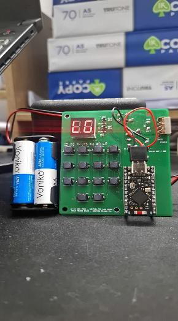
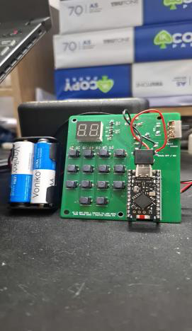
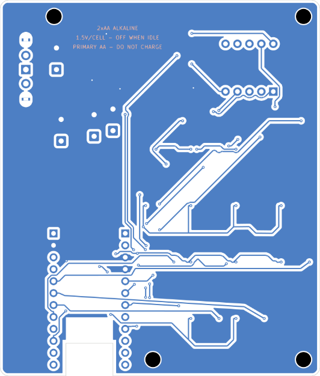
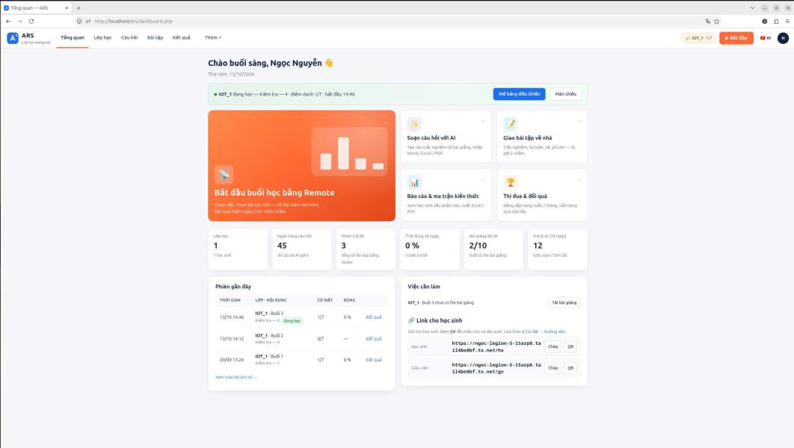
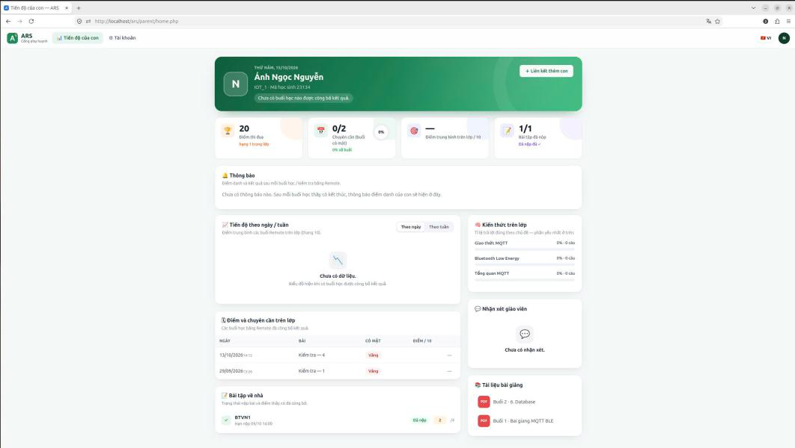
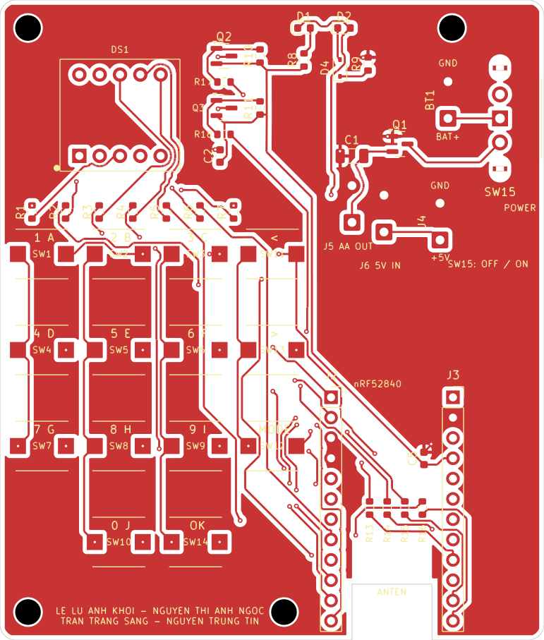
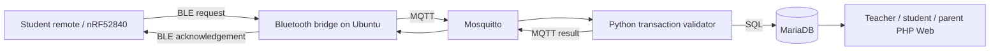

# nRF52840 Classroom Response System

**Custom PCB • Embedded C++ • BLE Advertising • Python • MQTT • MariaDB • PHP**

An end-to-end classroom-response prototype: a battery-powered nRF52840 handheld remote sends check-ins and multiple-choice answers to a local Ubuntu laptop. The server validates classroom transactions, stores results, and exposes teacher/student/parent interfaces. The core local workflow is designed to work without Internet connectivity.

> **Release status (24 Oct 2026):** The source tree combines the supplied server archive, **Rev J original KiCad source**, and the separately supplied **remote firmware v3.10–v3.17**. These are preserved as supplied, **not claimed to form one fully re-verified hardware/software release**. The v3.17 firmware README requires `ble_adv.py` and `ingest_adv.py`, but those modules were not in the supplied server ZIP. Source files for the separately discussed **ADV18** were also not included. Do not flash a firmware revision expecting that an older server will automatically recognize its packet format.

## Actual project photos and screenshots

The following images are from the project's own documentation and test artifacts. **Physical photos, PCB CAD previews, and web-interface screenshots are different forms of evidence.**

| Physical remote (front) | Physical remote (back) |
|:--:|:--:|
|  |  |

| PCB front view (CAD preview) | PCB back view (CAD preview) |
|:--:|:--:|
|  |  |

| Teacher dashboard (software screenshot) | Parent portal (software screenshot) |
|:--:|:--:|
|  |  |

## Hardware prototype

| Physical prototype | Rev J PCB |
|:--:|:--:|
|  |  |

- **MCU:** nRF52840 SuperMini, custom two-layer Rev J PCB
- **User interface:** 14-button matrix keypad, dual 7-segment LED display, red/green indicator
- **Power:** 2 × AA, reverse-polarity protection, external 5 V USB boost feeding the board's USB-C input
- **Design files:** [editable KiCad schematic and PCB](hardware/kicad/ARS_clicker_RevJ/), [BOM](hardware/kicad/ARS_clicker_RevJ/BOM_ARS_nRF52840_RevJ.xlsx), [prototype Gerbers](hardware/kicad/ARS_clicker_RevJ/gerber_prototype/)

## Architecture



A request is only considered committed after server-side validation and database persistence. The application identifies transactions across retries to avoid duplicate writes when radio acknowledgements are lost. BLE Advertising itself does not provide application acknowledgements. See [architecture details](docs/ARCHITECTURE.md).

## Directory map

| Directory | Contents |
|---|---|
| `firmware/ARS_remote_v3_17/` | Latest firmware in the uploaded archive (experimental Advertising) |
| `firmware/ARS_remote_v3_10/` ... `v3_16/` | Earlier supplied remote revisions; do not mix firmware and receiver formats |
| `firmware/ARS_remote_gatt/`, `firmware/ARS_gateway_v3_10/` | Alternate source modes from the server archive |
| `hardware/kicad/ARS_clicker_RevJ/` | Original editable KiCad, footprints, Gerbers, BOM, validation and previews |
| `bridge/` | Laptop BLE/GATT/serial bridge code in the supplied server archive |
| `ingest/`, `common/`, `db/` | Python processing, configuration utilities, MariaDB schema/migrations |
| `web/` | Teacher, student and parent PHP interfaces |
| `deploy/`, `tools/`, `tests/` | Ubuntu installation, diagnostics and tests |
| `docs/` | Architecture, version compatibility, test evidence and safety checklist |

## Firmware compatibility: read this before flashing

| Firmware | What is included | Compatibility status |
|---|---|---|
| `ARS_remote_v3_17` | Source with 400 ms ADV burst, `setInterval(160,160)` (= 100 ms units of 0.625 ms), 15 s state timeout | **Requires ADV16/17 server bridge not bundled here**; not end-to-end verified in this package |
| `ARS_remote_v3_10` | Source shipped in the new firmware ZIP | Check matching original server receiver and protocol before deployment |
| `ARS_remote_gatt` | GATT/NUS firmware included in original server ZIP | Alternative workflow, not the ADV17 protocol |
| `ARS_gateway_v3_10` | USB-connected gateway firmware in original server ZIP | Optional transport; needs matching serial bridge |

See [firmware compatibility notes](docs/FIRMWARE_COMPATIBILITY.md). **ADV18 is not included.**

## Run source-level checks

```bash
python3 -m compileall -q bridge common ingest tools tests
python3 tests/gateway_codec_test.py
bash tests/firmware_host/run.sh
find web -name '*.php' -print0 | xargs -0 -n1 php -l
```

Those checks do **not** prove hardware, performance, security or deployment compatibility.

## Ubuntu deployment (inspect first)

The provided installer changes Apache, Mosquitto, MariaDB and systemd configuration. Review it on a dedicated Ubuntu test machine before running with root privileges:

```bash
less deploy/install_ubuntu.sh
# Only after reviewing and configuring on a dedicated test host:
# sudo bash deploy/install_ubuntu.sh
```

See [existing installation documentation](HUONG_DAN_CAI_DAT.md) and [version compatibility](docs/FIRMWARE_COMPATIBILITY.md). Do not commit live `config.ini`, passwords, backups or student data.

## Measurements & limitations

The group report dated **14 Oct 2026** documents **34/34 transactions with returned results** (33 accepted, 1 expected rejection) in **one-remote physical testing**, with **597 ms median, 1,172 ms p95, 3,260 ms maximum** latency. These values come from the report; this source-release process did **not** rerun the radio experiment. No validated claim is made for 50 real remotes, battery autonomy, independently running Cloud, or the uploaded v3.17 firmware pairing with this older server. See [validation](docs/VALIDATION.md).

## Ownership & license

This is a **student team project**. Original source code is preserved without adding an invented license. Get agreement from all contributors before redistribution, and credit authors of hardware, firmware, backend and frontend. Third-party licenses are preserved where present. The class report with personally identifying student details, lecture materials and shop/downloaded datasheets are not copied into this source repository.

**Development prototype, not a production-certified deployment.**
