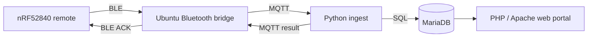

# nRF52840 Classroom Response System

**Embedded Systems · BLE Advertising · IoT · MQTT · Python · MariaDB · PHP**

A battery-powered nRF52840 classroom response prototype. Students check in and answer questions using the remote; an Ubuntu laptop receives Bluetooth packets, validates each transaction and serves dashboards for teachers, students and parents.

> **Project source status:** This repository currently contains the server and firmware shipped with its original release. The supplied firmware is in the ARS v3.10/v3.11 lineage; the separately tested ADV18 firmware and editable KiCad schematic/PCB were not present in the supplied server archive. They should only be added from authentic sources.

## End-to-end design



BLE advertising does not itself provide a reliable acknowledgement. The application uses transaction identifiers, retries and deduplication to reduce duplicate records after lost responses. An nRF52840 USB gateway and GATT/NUS are separate modes supported by the code and require matching firmware.

See [system architecture](docs/ARCHITECTURE.md).

## Hardware prototype

- nRF52840 SuperMini, two-layer PCB reported at 68 × 80 mm
- 14-key matrix, two-digit 7-segment LED and red/green status indicator
- Independent **2 × AA** battery supply, reverse-polarity protection, 5 V boost to USB-C
- Laptop's Bluetooth or optional USB nRF gateway, depending on the selected mode

See [hardware scope](hardware/README.md). Original editable KiCad designs are not currently distributed.

## Source structure

| Directory | Purpose |
| --- | --- |
| `firmware/` | Remote and optional gateway embedded code |
| `bridge/` | Bluetooth/serial receive and MQTT forwarding |
| `ingest/` | Validation, deduplication and result persistence |
| `db/` | Database schema and migrations |
| `web/` | Teacher, student and parent PHP interfaces |
| `deploy/` | Ubuntu installer, service and MQTT configuration |
| `tests/` | Source checks, integration and simulation tests |
| `tools/` | Diagnostic utilities |
| `docs/` | Architecture, testing and release notes |

## Installation on Ubuntu

The installer modifies system services and requires administrative privileges. Review it before execution on a non-production Ubuntu laptop.

```bash
git clone https://github.com/verasol23/nrf52840-classroom-response-system.git
cd nrf52840-classroom-response-system
less deploy/install_ubuntu.sh
sudo bash deploy/install_ubuntu.sh
```

See the [installation guide](HUONG_DAN_CAI_DAT.md) and [original server README](README_LEGACY.md) for operational commands. Match the receiver mode and physical remote firmware before running BLE tests.

## Reported testing

The October 14, 2026 class report documents **34/34** transactions receiving results with **one physical remote**, with median **597 ms**, p95 **1,172 ms**, and maximum **3,260 ms** end-to-end latency. These are reported measurements, not rerun in this repository update. The system has **not** been validated with 50 simultaneously transmitting physical remotes or for battery runtime. See [validation notes](docs/VALIDATION.md).

## Publication and credit

This is a student group project. Confirm permission and credit for contributed firmware, PCB, server code and third-party assets before redistributing. Do not upload real student details, private configuration or classroom lecture materials. Use the [release checklist](docs/RELEASE_CHECKLIST.md).

**Not production-certified:** Recheck security, account permissions, radio performance and cloud services before exposing the system publicly.
