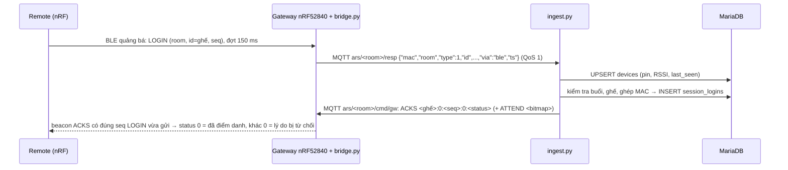

# ARS server — Hệ thống phản hồi lớp học bằng Remote

Phần mềm chạy trên **laptop giáo viên** (server). Học sinh bấm **Remote nRF52840** (Bluetooth Low Energy), một **gateway nRF52840 cắm USB** vào laptop thu sóng cả lớp; server nhận đáp án, kiểm tra hợp lệ, lưu vào MariaDB và hiển thị trên web giáo viên, màn chiếu, cổng học sinh và phụ huynh.

> Nguyên tắc thiết kế: **Remote và gateway chỉ truyền/nhận, không quyết định gì.** Mọi kiểm tra hợp lệ, lưu trữ, thống kê đều nằm ở server (`ingest/ingest.py`). Firmware có thể đơn giản, sửa luật chỉ cần sửa server.

Hướng dẫn sử dụng cho giáo viên, học sinh, phụ huynh và lập trình viên: **[huong-dan-su-dung/](huong-dan-su-dung/README.md)**

**Link Internet của máy chủ hiện tại (laptop giáo viên, dùng được ở nhà khi laptop bật):** giáo viên **https://ngoc-legion-5-15arp8.tail4be8bf.ts.net/gv** · học sinh **https://ngoc-legion-5-15arp8.tail4be8bf.ts.net/hs** · phụ huynh **https://ngoc-legion-5-15arp8.tail4be8bf.ts.net/ars/parent/**

Cài đặt, nạp firmware, chạy mỗi buổi và xử lý sự cố hệ thống 2 nRF (Remote + gateway USB): **[HUONG_DAN_2NRF.md](HUONG_DAN_2NRF.md)**

Chế độ 1 nRF — Remote kết nối BLE GATT thẳng với Bluetooth laptop, không cần gateway (`sudo ars gateway gatt`): **[HUONG_DAN_1NRF_GATT.md](HUONG_DAN_1NRF_GATT.md)**

Máy chủ Cloud 24/24 miễn phí cho học sinh / phụ huynh ở nhà (Oracle Cloud Free + Tailscale Funnel, `install_ubuntu.sh --cloud`): **[HUONG_DAN_CLOUD.md](HUONG_DAN_CLOUD.md)**

Những gì thay đổi ở V3.11 (tốc độ, độ chính xác, 3 chế độ thu sóng, giao diện Remote): **[CHANGES_V3_11.md](CHANGES_V3_11.md)**

Tài liệu khác: [HUONG_DAN_CAI_DAT.md](HUONG_DAN_CAI_DAT.md) (cài đặt chi tiết) · [UPGRADE_V10.md](UPGRADE_V10.md) (LMS, phụ huynh) · [UPGRADE_V11.md](UPGRADE_V11.md) (trường, Cloud, thi đua, Zalo/SMS) · [UPGRADE_V12.md](UPGRADE_V12.md) (đăng nhập Google, học sinh tự đăng ký) · [tests/README.md](tests/README.md)

---

## 1. Kiến trúc tổng quan

```
                         LAPTOP GIÁO VIÊN (server, chạy được offline)
 ┌──────────┐ BLE quảng bá ┌──────────┐ USB  ┌──────────────────┐ MQTT  ┌──────────────┐ SQL ┌─────────┐
 │ Remote   │─────────────▶│ Gateway  │─────▶│   bridge.py      │──────▶│  ingest.py   │────▶│ MariaDB │
 │ nRF52840 │◀─────────────│ nRF52840 │◀─────│(dịch vụ          │◀──────│ kiểm tra gói │◀────│  `ars`  │
 └──────────┘ beacon       └──────────┘serial│ ars-bridge)      │ STATE │ soạn STATE   │     └────▲────┘
  (mỗi học sinh 1 cái)     (cắm laptop)      └──────────────────┘       └──────────────┘          │ đọc/ghi
                                                                                ┌────┴─────┐
                                                                                │ Web PHP  │ ◀── trình duyệt GV,
                                                                                │ (Apache) │     màn chiếu, HS, PH
                                                                                └──────────┘
```

Phần cứng gồm **2 loại nRF52840**: **Remote** (mỗi học sinh một cái) và **một gateway** cắm USB vào laptop chạy server. Gateway nghe gói Remote phát ra, in thành dòng JSON qua cổng serial, và nhận lệnh trạng thái từ server để phát beacon ngược lại cho Remote. (Tuỳ chọn khi chưa có gateway: laptop dùng Bluetooth của chính nó — `ble_scan.py`, dịch vụ `ars-ble`, `sudo ars gateway ble`.)

| Thành phần | Vai trò |
|---|---|
| **Remote nRF52840** | Học sinh nhập số ghế (ID), chọn chữ A–J, bấm OK. Phát gói quảng bá LOGIN / ANSWER (mục 4.1); quét beacon của gateway để bật đèn xanh khi server đã nhận. |
| **Gateway nRF52840** | Cắm USB laptop. Quét gói Remote → mỗi gói 1 dòng JSON qua serial 115200 (mục 4.2b); nhận lệnh STATE/ATTEND/OPENMASK/ACKS → phát beacon. Không có logic. |
| **bridge.py** (dịch vụ `ars-bridge`) / **gateway.js** | Cầu nối serial ⇄ MQTT, không có logic; hoặc qua trình duyệt (Web Serial, `gateway.php`) khi gateway cắm vào máy GV khác. Tự nối lại khi rút/cắm USB. |
| **ble_scan.py** (dịch vụ `ars-ble`, tuỳ chọn) | Thay gateway khi chưa có: Bluetooth laptop ⇄ MQTT qua BlueZ (`sudo ars gateway ble`). `sudo ars ble` in mọi gói laptop nghe được để kiểm tra firmware Remote. |
| **Mosquitto** | MQTT broker: 1883 (chỉ trong máy), 9001 WebSocket có mật khẩu (qua Apache `/mqtt`, cho gateway cắm vào máy giáo viên qua trình duyệt). Không mở cổng MQTT ra mạng LAN. |
| **ingest.py** | "Trái tim": kiểm tra gói, ghi CSDL, soạn trạng thái gửi ngược cho Remote, tự đóng câu hết giờ. |
| **MariaDB** | Lưu toàn bộ dữ liệu (lớp, câu hỏi, buổi học, đáp án, LMS…). |
| **Web PHP** | Giáo viên điều khiển buổi học, màn chiếu, báo cáo; cổng học sinh / phụ huynh. **Web không nói MQTT**: chỉ ghi DB và tăng `sessions.state_rev`. |

---

## 2. Cây thư mục

```
ars-server/
├── README.md                     Tài liệu này
├── HUONG_DAN_2NRF.md            Chạy hệ thống 2 nRF từ đầu: cài, nạp firmware, mỗi buổi học, cập nhật, đo, xử lý sự cố
├── HUONG_DAN_CAI_DAT.md          Hướng dẫn cài đặt & vận hành chi tiết (Ubuntu, Windows, link cố định, Bluetooth / Remote nRF52840)
├── huong-dan-su-dung/            Hướng dẫn sử dụng: giáo viên, học sinh, phụ huynh, lập trình viên (README là mục lục)
├── UPGRADE_V10/V11/V12.md        Ghi chú nâng cấp từng phiên bản (migration, tính năng mới, giới hạn)
├── CHANGES_V10.md                Danh sách file thay đổi ở v10
├── config.ini.example            Mẫu cấu hình: DB, MQTT, room, cổng serial gateway, Bluetooth laptop [ble] (tuỳ chọn), uploads (chép thành config.ini)
│
├── firmware/
│   ├── ARS_remote_v3_10/         Firmware Remote nRF52840 (Arduino, Adafruit nRF52): bàn phím, LED 2 số, BLE, nhập ghế bằng MODE
│   ├── ARS_remote_gatt/          Firmware Remote chế độ 1 nRF: kết nối BLE GATT (NUS) với laptop, kết quả chính xác (bản V3.11 GATT của nhóm)
│   ├── GATT_PROTOCOL_V3_11.md    Giao thức chế độ GATT
│   ├── ARS_gateway_v3_10/        Firmware gateway nRF52840 SuperMini cắm USB: quét Remote → JSON, lệnh → beacon, lọc bản lặp
│   ├── PROTOCOL_V3_10.md         Giao thức BLE + lịch radio + so sánh V3.9 → V3.10
│   └── TEST_V3_10.md             Quy trình test radio, tiêu chí PASS/FAIL
├── bridge/
│   ├── ble_gatt.py, gatt_protocol.py  Chế độ 1 nRF GATT: một kết nối BLE tới Remote ⇄ MQTT, ghép kết quả theo mã yêu cầu
│   ├── bridge.py                 Gateway nRF52840 USB serial ⇄ MQTT. Tự nối lại khi rút/cắm USB. Báo gw/status mỗi 5 s
│   ├── blecodec.py               Định dạng byte trên sóng Remote ⇄ gateway/laptop (mã hoá / giải mã, tham chiếu cho firmware gateway, dùng cho test)
│   └── ble_scan.py               (tuỳ chọn, khi chưa có gateway) Bluetooth laptop ⇄ MQTT qua BlueZ
├── ingest/
│   └── ingest.py                 Nhận gói từ MQTT → kiểm tra → ghi DB → phát STATE/ATTEND/OPENMASK/ACKS
├── common/
│   └── arscfg.py                 Dùng chung cho Python: đọc config.ini, kết nối DB, mã hoá bitmap ghế / mặt nạ câu
├── tools/
│   ├── sim_clickers.py           Giả lập N Remote V3.10 ở tầng MQTT (ACK chính xác, gửi lại, thử tải)
│   ├── ble_txn_report.py         Đọc log serial Remote + journalctl → ACK lần đầu / gửi lại / NACK / UPLINK_MISS / ACK_MISS, PASS/FAIL
│   ├── ble_probe.py              Đo radio card Bluetooth laptop: phát ACK khi đang quét, bắt gói khi đang phát (cùng Remote ở chế độ d/u)
│   ├── ble_diag_collect.sh       Gom thông tin card, main.conf, journalctl, btmon → một file .tar.gz
│   ├── i18n_wrap.py              Công cụ dịch: bọc chuỗi tiếng Việt bằng t()/te(), liệt kê khoá dịch
│   ├── i18n_collect.py           Duyệt mọi trang trên máy chủ thử, liệt kê chữ tiếng Việt chưa có bản dịch
│   └── i18n_static.py            Quét mã nguồn PHP, liệt kê chữ tiếng Việt chưa có bản dịch
│
├── db/
│   ├── schema.sql                Bảng lõi: teachers, classes, students, devices, question_sets, questions, sessions,
│   │                             session_questions, session_logins, responses, rejected, gateways, VIEW final_answers
│   ├── migrate_002_hocsinh.sql   Cổng học sinh: tài khoản HS, bài ôn tập, lượt luyện tập, sổ câu sai
│   ├── migrate_003_*.sql         Buổi học/bài giảng, cài đặt, nhật ký AI, mã tham gia lớp, trợ lý học tập
│   ├── migrate_004_*.sql         Nhiều giáo viên (quản trị, khoá), kiểu kết nối lớp
│   ├── migrate_005_lms.sql       Trường, kho đề, media câu hỏi, ghép Remote ↔ học sinh, bài tập về nhà, phụ huynh
│   ├── migrate_006_*.sql         Admin trường/lớp hành chính, đồng bộ Cloud, thi đua đổi quà, thông báo Zalo/SMS
│   ├── migrate_007_oauth.sql     Đăng nhập Google (bản cũ có cả Facebook)
│   ├── migrate_008_*.sql         Học sinh tự đăng ký chưa cần lớp
│   ├── migrate_009_language.sql  Ngôn ngữ giao diện theo tài khoản (vi / en)
│   ├── migrate_010_tutor_chats.sql  Trợ lý AI: nhiều cuộc trò chuyện, đánh giá 👍/👎
│   ├── migrate_011_set_finalize.sql Bộ câu hỏi: trạng thái Đang soạn / Đã hoàn tất
│   ├── migrate_012_nrf_only.sql     Chỉ dùng phần cứng nRF52840 (mọi lớp kết nối Bluetooth)
│   └── migrate_013_no_facebook.sql  Bỏ đăng nhập Facebook (xoá liên kết + cấu hình Facebook cũ)
│
├── deploy/                       Cài đặt & vận hành trên Ubuntu
│   ├── install_ubuntu.sh         Cài một lệnh: Apache+PHP, MariaDB, Mosquitto, Python libs, chép code vào /opt/ars-server
│   ├── ars                       Lệnh tiện ích: ars status | logs | ports | gateway usb/ble | ble | ble-tune | watch | sim | links | public on/off | backup…
│   ├── ars-watch                 Xem CSDL trực tiếp (gói vào/bị loại) trên terminal
│   ├── ars-ingest.service        systemd: chạy ingest.py
│   ├── ars-bridge.service        systemd: bridge.py cho gateway USB (nhóm dialout)
│   ├── ars-ble.service           systemd (tuỳ chọn, tắt sẵn): ble_scan.py (nhóm bluetooth, tự rfkill unblock)
│   ├── 99-ars-usb.rules          udev: ModemManager không chiếm cổng SuperMini (gateway / Remote)
│   ├── ars-mdns.service/.sh      Quảng bá tên ars.local trong LAN
│   ├── apache-ars.conf           Alias /ars → web/, link ngắn /gv /hs, chặn lib/, proxy WebSocket /mqtt
│   └── mosquitto-ars.conf        2 listener MQTT (1883 nội bộ, 9001 WebSocket có mật khẩu)
│
├── web/                          Ứng dụng web PHP (document root /ars)
│   ├── index.php · register.php · forgot.php · logout.php     Đăng nhập / tạo tài khoản / quên mật khẩu giáo viên
│   ├── portal.php · go.php · privacy.php                       Trang chọn vai trò, link ngắn /gv /hs, chính sách quyền riêng tư
│   ├── oauth.php                 Đăng nhập / đăng ký / liên kết bằng Google (cả 3 vai trò)
│   ├── dashboard.php             Tổng quan giáo viên
│   ├── classes.php · class.php   Danh sách lớp; một lớp: học sinh, nhập Excel, mã tham gia, bắt đầu buổi, giao ôn tập
│   ├── session.php               BẢNG ĐIỀU KHIỂN BUỔI HỌC (mở/đóng câu, lưới ghế cập nhật mỗi giây)
│   ├── projector.php             Màn chiếu cho cả lớp (câu hỏi, đồng hồ, biểu đồ khi GV cho hiện)
│   ├── gateway.php               Gateway USB cắm máy GV: Web Serial ⇄ MQTT ngay trong Chrome/Edge
│   ├── sessions.php · results.php · export.php   Lịch sử buổi; kết quả (p, D, phương án nhiễu); xuất Excel
│   ├── devices.php · mapping.php Tình trạng Remote (pin, RSSI, gói trùng) & bộ thu Bluetooth; ghép MAC Remote ↔ ghế học sinh
│   ├── sets.php · set.php · compose.php          Ngân hàng câu hỏi; soạn câu; tách câu từ Word/Excel/PDF + trợ lý AI
│   ├── media.php · question_file.php             Gắn ảnh/audio/video vào câu hỏi; phục vụ tệp có kiểm tra quyền
│   ├── library.php · variants.php                Kho đề dùng chung (riêng/trường/công khai); tạo mã đề đảo câu/phương án
│   ├── set_export.php · set_docx.php · set_print.php · template*.php   Xuất đề Excel/Word/PDF; file mẫu
│   ├── lessons.php · lesson.php · file.php       Buổi học: bài giảng, kiến thức trọng tâm, câu củng cố; tải bài giảng
│   ├── homework.php · homework_grade.php · lms_file.php   Bài tập về nhà; chấm (AI gợi ý); tệp bài làm
│   ├── analytics.php · cohort.php                Báo cáo & ma trận chủ đề; tổng hợp lớp hành chính (GV chủ nhiệm)
│   ├── family.php                Mã mời phụ huynh, nhận xét, khối lớp
│   ├── rewards.php               Thi đua: bảng xếp hạng, cửa hàng quà, duyệt quà
│   ├── school.php · schools.php · teachers.php   Admin trường; quản trị trường; quản trị giáo viên
│   ├── sync.php · notify.php     Đồng bộ lên Cloud; cấu hình & nhật ký Zalo/SMS
│   ├── settings.php · practice_log.php           Cài đặt (AI, đường dẫn, kết nối clicker Bluetooth, đăng nhập Google); lịch sử luyện tập HS
│   ├── api/
│   │   ├── state.php             JSON trạng thái buổi học (bảng điều khiển & màn chiếu gọi mỗi giây)
│   │   ├── action.php            Lệnh điều khiển: mở/đóng/chiếu câu, hiện kết quả, giải phóng ghế, kết thúc → tăng state_rev
│   │   ├── qparse.php · qadd.php · ai.php        Tách câu hỏi; thêm câu vào bộ; trợ lý AI soạn câu / tóm tắt
│   │   └── sync.php              Cloud nhận dữ liệu từ server lớp học (xác thực bằng mã đồng bộ)
│   ├── student/                  Cổng học sinh: home, homework, wrong/right (câu sai/đúng), practice/quiz/review,
│   │                             lectures/lecture, lessons (rút kinh nghiệm), tutor + api_tutor (AI), rewards, register…
│   ├── parent/                   Cổng phụ huynh: index (đăng nhập/đăng ký bằng mã mời), home (tiến độ của con)
│   ├── lang/en.php               Từ điển tiếng Anh (khoá = câu tiếng Việt trong mã)
│   ├── lib/                      Thư viện PHP (bị chặn truy cập trực tiếp):
│   │   ├── i18n.php              Đa ngôn ngữ: t()/te(), chọn ngôn ngữ (?lang=en|vi, cookie, theo tài khoản), dịch toàn trang i18n_html()
│   │   ├── bootstrap.php         Cấu hình, PDO, phiên, CSRF, quyền sở hữu lớp/buổi, giao diện chung, bump_state()
│   │   ├── student.php · lms.php Dùng chung cổng HS; bài tập về nhà, tệp, phụ huynh
│   │   ├── stats.php · sheet.php Thống kê buổi học; đọc/ghi .xlsx/.csv không cần thư viện
│   │   ├── qparse.php · qbank.php · extract.php · variants.php   Tách câu, lưu câu, đọc chữ PDF/PPTX/DOCX, mã đề
│   │   ├── ai.php · ai_offline.php · tutor.php   Trợ lý AI (Claude/OpenAI/Ollama hoặc offline); trợ lý học sinh
│   │   ├── school.php · rewards.php · sync.php · notify.php · oauth.php · auth_ui.php   Tính năng v11–v12
│   │   └── settings_links.php    Phần Đường dẫn / Kết nối clicker của trang Cài đặt
│   └── assets/                   CSS/JS: style.css, student.css, control.js (bảng điều khiển), projector.js,
│                                 gateway.js (Web Serial), fx.js (hiệu ứng), capture.js (vẽ/ghi âm), math.js + vendor/ (KaTeX, mqtt.js, qrcode)
│
├── tests/                        Test tích hợp chạy trên CSDL tạm: `bash tests/run_local.sh` (xem tests/README.md)
└── mau/                          Tệp mẫu: đề Word, dữ liệu thử Excel, bài giảng PDF
```

---

## 3. Workflow: từ lúc Remote bấm đến lúc dữ liệu được lưu

### 3.1 Trước buổi học
1. Giáo viên tạo **lớp** với **mã lớp (room, 1–255)** và danh sách học sinh (**số ghế 1–99** = ID học sinh gõ trên Remote).
2. Gateway phải phục vụ đúng room đó: `config.ini → [gateway] room` (dùng cho `bridge.py`; khi Remote đổi room thì gói vẫn được chuyển đúng `ars/<room>/resp`, nhưng trạng thái chỉ gửi xuống gateway cho room này).
3. Giáo viên bấm **Bắt đầu** → tạo dòng `sessions` (status `running`). Mỗi room chỉ có **một buổi đang chạy**.

### 3.2 Điểm danh (LOGIN)


### 3.3 Trả lời câu hỏi (ANSWER)
1. GV bấm **Mở câu** trên `session.php` → `api/action.php` ghi `session_questions` (status `open`, `deadline` theo đồng hồ MariaDB `NOW(3)`) → **tăng `sessions.state_rev`**.
2. `ingest.py` (vòng `state_loop`, mỗi 0,3 s) thấy `state_rev` đổi → phát `STATE <room> <qid> 1 <n_options> <bitmap>` + `OPENMASK` → gateway phát beacon → Remote biết câu `qid` đang mở.
3. Học sinh chọn chữ, bấm OK → Remote phát ANSWER (`q` = số thứ tự câu trong bộ, `ans`, `seq` mới) trong một đợt 150 ms.
4. Gateway nghe gói (một hoặc nhiều bản lặp) → dòng JSON qua USB → `bridge.py` → `ars/<room>/resp` → ingest **kiểm tra theo thứ tự**:

   | # | Kiểm tra | Lý do loại (`rejected.reason`) |
   |---|---|---|
   | 1 | Đủ trường, kiểu đúng, MAC 17 ký tự, type 1/2, room 0–255 | `malformed` |
   | 2 | Room có buổi đang chạy | `no_session` |
   | 3 | Gói phải đến qua Bluetooth (`via` = `ble`) | `wrong_link` |
   | 4 | Nếu ghế/MAC đã ghép cố định (mapping.php) thì phải khớp | `mapping_mismatch` |
   | 5 | MAC đã điểm danh, và đúng ghế đã điểm danh | `not_logged_in` · `id_mismatch` |
   | 6 | Câu `q` đã được mở trong buổi | `q_not_open` |
   | 7 | **Gói trùng** (cùng câu, MAC, seq) → bỏ qua, chỉ đếm `devices.pkt_dup` | (không phải lỗi) |
   | 8 | Câu còn mở, chưa quá hạn | `q_closed` · `late` |
   | 9 | Chữ nằm trong số lựa chọn của câu | `bad_option` |
   | 10 | Nếu buổi không cho đổi đáp án: ghế chưa trả lời câu này | `no_change` |

   (LOGIN có thêm: `unknown_seat` ghế không có trong lớp, `seat_taken` ghế đã có máy khác, `mac_bound` máy đã gắn ghế khác.)
5. Hợp lệ → ghi `responses` → bản ghi **ACK chính xác** `(ghế, câu, seq, đáp án, status 0)` của ghế đó, phát ngay trong gói ACKS. Bị loại → bản ghi **NACK** cùng định danh, `status` = mã lý do.
6. Remote thấy bản ghi **khớp đúng ghế + câu + seq + đáp án** → đèn xanh (NACK → đèn đỏ, Serial in lý do). STATE không bao giờ được dùng làm ACK. Không thấy trong 1 s → nghỉ ngẫu nhiên rồi gửi lại **cùng seq** (tối đa 4 lần); server coi là trùng, không ghi 2 lần, chỉ gia hạn ACK.
7. Bảng điều khiển và màn chiếu đọc `api/state.php` mỗi giây → ô học sinh chuyển xanh, biểu đồ cập nhật.
8. Hết giờ: `ingest` tự đóng câu (`status=closed`) và phát STATE `open=0`. GV bấm **Kết thúc buổi** → `sessions.status=ended`.

### 3.4 Lưu trữ
| Bảng | Nội dung |
|---|---|
| `devices` | Mỗi MAC: pin (mV), RSSI, room/ghế gần nhất, lần cuối thấy, tổng gói, gói trùng |
| `session_logins` | Điểm danh: (buổi, ghế, MAC, thời điểm) — duy nhất theo ghế và theo MAC |
| `responses` | **Mọi lượt bấm hợp lệ** (kể cả đổi đáp án): ghế, MAC, seq, chữ, RSSI, thời điểm ms |
| `final_answers` (VIEW) | Đáp án cuối của mỗi ghế cho mỗi câu = lượt có `id` lớn nhất — dùng cho chấm điểm, thống kê |
| `rejected` | Gói bị loại + lý do + bản gốc (gộp 5 bản lặp của một lần bấm thành 1 dòng trong 10 s) |
| `gateways` | Trạng thái gateway USB (hoặc Bluetooth laptop) theo room: online, gói/giây, cổng, cập nhật lúc |
| `sessions`, `session_questions` | Buổi học, câu đã mở/đóng, hạn giờ, `state_rev`, `show_result` |

Sau buổi học, kết quả được dùng cho: trang Kết quả, báo cáo/ma trận chủ đề, sổ câu sai của học sinh, điểm thi đua, tin Zalo/SMS cho phụ huynh, đồng bộ lên Cloud (`sync.php`).

---

## 4. Giao thức truyền / nhận

### 4.1 Remote ⇄ Gateway (BLE quảng bá, không kết nối)
- Remote **phát gói quảng bá** (advertising) LOGIN/ANSWER; gateway **quét** (hoặc laptop qua BlueZ, `ble_scan.py`) — không ghép đôi, không kết nối GATT, nên cả lớp gửi cùng lúc được.
- Gateway **phát beacon** (quảng bá non-connectable) chứa trạng thái; mọi Remote cùng quét để biết câu đang mở và đã được nhận chưa.
- Một lần bấm OK = **1 seq**: một đợt quảng bá 150 ms (≈ 6 sự kiện) rồi nghe ACK 1 s; chưa có thì gửi lại cùng seq (tối đa 4 lần). Bấm lần mới → seq tăng (0–255, quay vòng). Chi tiết lịch radio: [firmware/PROTOCOL_V3_10.md](firmware/PROTOCOL_V3_10.md).
- Định danh Remote = **địa chỉ BLE** của nó → firmware dùng địa chỉ **random static** cố định (mặc định của nRF52840), không bật privacy (địa chỉ đổi liên tục sẽ bị coi là máy khác).
- Dữ liệu nằm trong **Manufacturer Specific Data** (AD type `0xFF`), mã công ty `[ble] company_id` (mặc định `0xFFFF` — mã thử nghiệm), byte đầu `0xA5`. Mã nguồn tham chiếu: `bridge/blecodec.py`.

**Remote → gateway** (9 byte sau mã công ty):

| Byte | Ý nghĩa |
|---|---|
| 0 | `0xA5` (dấu nhận diện ARS) |
| 1 | type: `1` = LOGIN, `2` = ANSWER |
| 2 | room (0–255) |
| 3 | số ghế / ID (1–99) |
| 4 | câu q (1–64; LOGIN: 0) |
| 5 | seq (0–255) |
| 6 | đáp án: `0` = không có, `1`–`10` = A–J (hoặc mã ASCII `'A'`–`'J'`) |
| 7–8 | pin mV, uint16 little-endian (`0` = không đo) |

Ví dụ ghế 7, room 1, câu 3, seq 12, chọn B, pin 2950 mV: company `0xFFFF`, data `A5 02 01 07 03 0C 02 86 0B`.
Trong firmware nRF5 SDK / Zephyr: `BT_DATA(BT_DATA_MANUFACTURER_DATA, {0xFF,0xFF, 0xA5,0x02,0x01,0x07,0x03,0x0C,0x02,0x86,0x0B}, 11)`.

**Gateway → Remote** (beacon, cùng mã công ty; ACKS ưu tiên, STATE/ATTEND/OPENMASK phát thành burst ngắn khi không có ACK):

| Gói | Byte |
|---|---|
| STATE | `A5 10` room qid open(0/1) **n_options** + bitmap 13 byte ghế **đã có đáp án** câu qid |
| ATTEND | `A5 11` room + bitmap 13 byte ghế **đã điểm danh** |
| OPENMASK | `A5 12` room + 8 byte mặt nạ câu đang mở (câu p ở bit p−1) — cho phím ◀ ▶ |
| ACKS | `A5 13` room n + n bản ghi **(ghế, câu, seq, đáp án, status)**, n ≤ 4 — 4 kết quả mới nhất, mỗi ghế hết hạn sau 1,8 s |

Remote chỉ đọc beacon có room trùng room mình nhớ; dùng `n_options` để chặn tại chỗ đáp án vượt số lựa chọn, ACKS để xác nhận đúng giao dịch vừa gửi — cả ANSWER lẫn LOGIN (V3.11: bản ghi LOGIN là `(ghế, 0, seq, 0, status)`; ATTEND chỉ là thông tin). (Chế độ Bluetooth laptop: phát beacon cần Linux, BlueZ ≥ 5.50; trên Windows/macOS `ble_scan.py` chỉ nghe.)

### 4.2 Dữ liệu gói và lệnh trạng thái
**Dạng JSON** (gateway in ra mỗi dòng qua USB, hoặc ble_scan.py giải mã ra) — đây là dữ liệu ingest nhận:
```json
{"mac":"C4:1A:00:11:22:33","room":1,"type":2,"id":7,"q":3,"seq":12,"ans":"B","batt":2950,"rssi":-61}
```
| Trường | Kiểu | Ý nghĩa |
|---|---|---|
| `mac` | `AA:BB:CC:DD:EE:FF` | Địa chỉ Remote (định danh thiết bị) |
| `room` | 0–255 | Mã lớp Remote đang nhớ |
| `type` | 1 / 2 | 1 = LOGIN (điểm danh), 2 = ANSWER |
| `id` | 1–99 | Số ghế học sinh nhập |
| `q` | 1–64 | Số thứ tự câu trong bộ (LOGIN: 0) |
| `seq` | 0–255 | Số thứ tự lần bấm (5 bản lặp cùng seq) |
| `ans` | `A`–`J` | Chữ đã chọn (LOGIN: rỗng). Phím 1–9 = A–I, 0 = J |
| `batt` | mV | Điện áp pin (cảnh báo dưới `[ingest] low_batt_mv`, mặc định 2600) |
| `rssi` | dBm | Cường độ sóng bộ thu đo được |

**Lệnh trạng thái** ingest gửi xuống (`ars/<room>/cmd/gw`), bridge ghi nguyên dòng xuống gateway, gateway chuyển thành beacon:
| Lệnh | Ý nghĩa |
|---|---|
| `STATE <room> <qid> <open 0/1> <n_options> <13 byte hex>` | Câu đang chiếu, đang mở hay đóng, số lựa chọn, bitmap ghế **đã có đáp án** câu đó |
| `ATTEND <13 byte hex>` | Bitmap ghế **đã điểm danh** |
| `OPENMASK <8 byte hex>` | Các câu đang mở (câu p ở bit p−1) — cho phím ◀ ▶ chuyển câu trên Remote |
| `ACKS <ghế:câu:seq:đáp_án:status,...>` hoặc `ACKS -` | Kết quả chính xác gần nhất (mỗi ghế 1 bản ghi; gói quảng bá giữ 4 bản ghi mới nhất). `status` 0 = nhận, khác 0 = mã lý do NACK |

**Bitmap:** ghế n ở byte `n ÷ 8`, bit `n mod 8`, bit thấp trước, 13 byte = 104 bit (`common/arscfg.py → bitmap_hex`). Ví dụ ghế 1–4 → `1E000000000000000000000000`.
Server phát lại toàn bộ trạng thái khi có thay đổi (≤ 0,3 s) **và định kỳ mỗi 5 s** (`[ingest] state_refresh_s`), nên bộ thu khởi động lại hay mất một lệnh vẫn tự đúng.

### 4.2b Gateway nRF52840 cắm USB
Cắm vào máy chủ (dịch vụ `ars-bridge`; `[gateway] serial = auto` tự tìm cổng trả lời `# ARS-GW` — Remote cắm cùng lúc không bị nhận nhầm; `ars gw` xem tình trạng) hoặc vào máy giáo viên qua trình duyệt (bảng điều khiển → **Gateway USB máy này**). **115200 baud, 8N1**:
- **Lên:** mỗi gói Remote nghe được (byte như mục 4.1) → 1 dòng JSON như mục 4.2, thêm `rssi`. Dòng không bắt đầu bằng `{` là log, bị bỏ qua.
- **Xuống:** mỗi lệnh trạng thái 1 dòng ASCII (`STATE …`, `ATTEND …`, `OPENMASK …`, `ACKS …`) → gateway mã hoá thành beacon như mục 4.1 và phát liên tục tới khi có lệnh mới cùng loại (`ACKS -` = ngừng phát ACK). Mã hoá / giải mã tham chiếu: `bridge/blecodec.py` (`decode_uplink`, `encode_cmd`).
- **Lọc bản lặp** ngay trên gateway: mỗi lần bấm (~6 bản trong 150 ms) chỉ 1 dòng lên USB; bản giống hệt trong 300 ms bị bỏ, lần gửi lại sau ≥ 1 s vẫn lên. Dòng `# STAT …` mỗi 5 s là thống kê của gateway.
- Firmware: [firmware/ARS_gateway_v3_10/](firmware/ARS_gateway_v3_10/README.md) (nRF52840 SuperMini). Mã hoá/giải mã là bản C++ của `blecodec.py`, kiểm tra từng byte bằng `tests/gateway_codec_test.py`.

Chưa có gateway: dùng tạm Bluetooth của laptop — `sudo ars gateway ble` (quay lại: `sudo ars gateway usb`).

### 4.3 MQTT (bên trong server)
| Topic | Chiều | QoS | Nội dung |
|---|---|---|---|
| `ars/<room>/resp` | bridge.py / gateway.js (hoặc ble_scan.py) → ingest | 1 | JSON gói như 4.2, thêm `via` (`ble`), `ts` |
| `ars/<room>/cmd/gw` | ingest → bridge.py / gateway.js (hoặc ble_scan.py) | 1 | Một lệnh STATE / ATTEND / OPENMASK / ACKS |
| `ars/<room>/state` | ingest → mọi bên | 1, **retain** | JSON trạng thái đầy đủ (`qid, open, answered[], attend[], open_positions[], acks, mode, cmds[]`). Bộ thu vừa khởi động đọc bản giữ lại để phát beacon ngay |
| `ars/<room>/live` | ingest → (tuỳ chọn) | 0 | Số đã trả lời, phân bố đáp án |
| `ars/<room>/gw/status` | bridge / ble_scan.py → ingest | 1, retain | `{"online", "port", "pkt_per_s"}` mỗi 5 s (`port` = cổng USB, `webserial`, hoặc `bluetooth hci0`); Last Will = offline |

Phần cứng chỉ dùng **nRF52840** (Remote + gateway) nên mọi gói đều đến qua Bluetooth (gateway USB, hoặc `ble_scan.py`); MQTT chỉ mở trong máy (1883) và qua WebSocket `/mqtt` có mật khẩu (cho gateway cắm vào máy giáo viên).

### 4.4 Lưu ý khi sử dụng
- **Room phải khớp**: lớp đang học ↔ `[gateway] room` ↔ room Remote nhớ. Sai room → gói bị loại `no_session`. Đổi room: học sinh nhập lại ID trên Remote.
- **Chỉ nhận gói qua Bluetooth**: gói có `"via"` khác `ble` bị loại `wrong_link`.
- **Gateway phải cắm và đúng cổng**: web báo "Gateway: chưa kết nối" khi bridge chưa mở được cổng — xem `ars ports`, sửa `[gateway] serial`, `sudo systemctl restart ars-bridge`. Đặt gateway giữa lớp (cáp USB nối dài nếu cần).
- Kiểm tra Remote mới nạp firmware: `ars mqtt` xem gói gateway chuyển lên; hoặc (không cần gateway) `sudo ars ble` in mọi gói laptop nghe được, dòng `→ ARS {...}` là gói đúng định dạng 4.1.
- (Chế độ Bluetooth laptop) dịch vụ `ars-ble` tự bỏ chặn và bật adapter; tắt Bluetooth giữa giờ → web báo "Bluetooth laptop: chưa bật".
- **Một ID một máy** trong một buổi. Học sinh đổi Remote giữa giờ → GV bấm ô ghế để **giải phóng ID**, rồi học sinh điểm danh lại.
- **Ghép Remote cố định** (Thiết bị → Ghép Remote) chống mượn máy bấm hộ; đổi ghép ngoài giờ học.
- Tỉ lệ **gói trùng**: với gateway gần như 0 (gateway đã lọc bản lặp); với Bluetooth laptop thì cao là bình thường (mỗi đợt phát khoảng 6 sự kiện quảng bá cùng seq). Nhiều gói `late`/`q_closed` = học sinh bấm sau khi đóng câu.
- Thời gian (mở câu, hạn giờ, nhận gói) đều lấy theo **đồng hồ MariaDB** — web và ingest không lệch giờ nhau.
- (Gateway USB) rút ra cắm lại: bridge tự nối lại sau 2 s và phát lại trạng thái giữ lại. Linux thường là `/dev/ttyACM0` (người dùng dịch vụ cần nhóm `dialout`); Windows là `COMx` — xem `python bridge/bridge.py --list`.
- Bộ câu dùng với Remote tối đa **64 câu** (mặt nạ OPENMASK 8 byte), lớp tối đa **99 ghế**, câu 2–10 lựa chọn (A–J).
- (Gateway USB) qua trình duyệt (`gateway.php`) cần **Chrome/Edge** và trang mở bằng **https hoặc localhost**; giữ tab mở suốt buổi.
- Xem trực tiếp: `ars logs` (gói vào / bị loại), `ars watch`, trang **Thiết bị** (pin, RSSI, lần cuối thấy), bảng "Gói bị server từ chối" trên bảng điều khiển.

---

## 5. Chạy nhanh

**Ubuntu (khuyên dùng):**
```bash
sudo bash deploy/install_ubuntu.sh        # cài/cập nhật; giữ nguyên config.ini và dữ liệu
ars status                                # apache2, mariadb, mosquitto, ars-ingest, ars-bridge
ars ports                                 # tìm cổng gateway; khác /dev/ttyACM0 thì sửa [gateway] serial rồi restart ars-bridge
```
Mở `http://localhost/gv` (giáo viên) · `http://localhost/hs` (học sinh) · `/ars/parent/` (phụ huynh). Lần đầu tạo tài khoản quản trị.
Link Internet https: `sudo ars public on` (Tailscale Funnel).

**Cập nhật code đã cài:**
```bash
sudo rsync -a --delete --exclude config.ini --exclude .gateway-ble --exclude .gateway-gatt --exclude .git --exclude '__pycache__' ./ /opt/ars-server/
sudo systemctl restart apache2 ars-ingest ars-bridge
```
Có migration mới (`db/migrate_00X_*.sql`) thì chạy trước: `mysql -u root -p ars < db/migrate_00X_….sql`.

**Windows / chạy tay:** XAMPP (Apache + MariaDB) + Mosquitto + Python 3.10 (`pip install paho-mqtt pymysql pyserial`); tạo CSDL bằng `schema.sql` rồi lần lượt `migrate_002` → `009`; chép `config.ini.example` → `config.ini`; mỗi buổi chạy `python ingest/ingest.py` và `python bridge/bridge.py` (cổng `COMx` trong `[gateway] serial`, xem `python bridge/bridge.py --list`). Chi tiết: [HUONG_DAN_CAI_DAT.md](HUONG_DAN_CAI_DAT.md).

**Không có phần cứng:**
```bash
ars sim 30            # hoặc: python3 tools/sim_clickers.py --room 1 -n 30 [--loss 0.3]
```
Mở bảng điều khiển, bấm **Mở câu** — các ô chuyển xanh dần; cuối chạy bộ giả lập in tỉ lệ xác nhận và độ trễ bấm OK → đèn xanh.

**Test:** `bash tests/run_local.sh` (CSDL tạm, không đụng dữ liệu thật).

---

## 6. Ngôn ngữ giao diện (Tiếng Việt / English)

- Giáo viên và phụ huynh chọn **🇻🇳 VI / 🇬🇧 EN** ở thanh trên (hoặc màn đăng nhập). Lựa chọn lưu theo cookie và theo tài khoản (đăng nhập máy khác vẫn giữ). Lần đầu mở, trình duyệt đặt tiếng Anh sẽ thấy tiếng Anh. Cổng học sinh cũng có nút VI / EN.
- Đã dịch: thanh trên, đăng nhập / đăng ký / quên mật khẩu, Tổng quan, Lớp học, trang lớp, bảng điều khiển + màn chiếu (cả JavaScript), Kết quả, cổng phụ huynh, Google. Trang chưa dịch hiện tiếng Việt.
- **Ngôn ngữ khác (Google Dịch):** cuối menu ngôn ngữ, dịch máy toàn bộ trang sang mọi ngôn ngữ Google Dịch hỗ trợ (danh sách lấy trực tiếp từ Google, luôn mới). Cần Internet; script Google chỉ tải khi người dùng chọn; nội dung trang (kể cả tên, điểm học sinh) được gửi tới Google — quản trị tắt được ở Cài đặt → Thông tin chung. Chữ cái đáp án, phím Remote, số ghế, tên ARS gắn `translate="no"`.
- Thêm bản dịch: bọc chuỗi bằng `t('…')` / `te('…')` (PHP) hoặc `T('…')` (JS, trong control.js / projector.js); biến dạng `{n}`. `python3 tools/i18n_wrap.py keys web` liệt kê mọi khoá → thêm vào `web/lang/en.php`.
- Dịch toàn trang: khi chọn tiếng Anh, `i18n_html()` lọc HTML trước khi gửi (chữ giữa các thẻ, placeholder/title, confirm) và `assets/i18n.js` dịch chữ do JavaScript chèn vào — cùng từ điển `web/lang/en.php`, số trong câu viết `{n}`. Tìm chữ còn sót: `KEEP=1 bash tests/run_local.sh` rồi `python3 tools/i18n_collect.py /tmp/ars-test.XXXX/smoke.json` (thêm `EN=1` để xem chữ Việt còn sót trên giao diện tiếng Anh).
