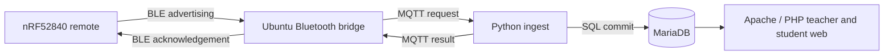

# System architecture

The classroom response system includes an nRF52840 remote, an Ubuntu laptop, and a local website.

A USB nRF52840 gateway and a GATT/NUS firmware/bridge are alternatives in the supplied source. They are not interchangeable with the advertising firmware without matching configuration.

## Transaction safety

Each request carries a transaction identity. The ingest service validates the room/session, seat, question and answer eligibility before recording a result. If acknowledgement is lost, retrying the same transaction should return the existing decision instead of creating duplicate records. This is an application-level mechanism, not an acknowledgement offered by BLE advertising.

## Deployment

Local components include BLE receive/transmit, Mosquitto, Python ingest, MariaDB and PHP/Apache. Basic classroom processing does not require Internet. Optional remote services should be configured and verified independently.
