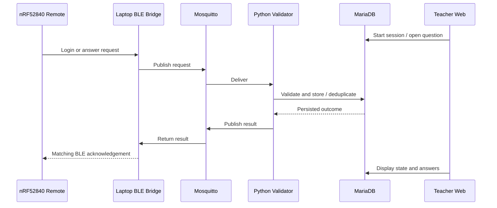

# System architecture and workflow

The laptop hosts the Bluetooth receiver, Mosquitto MQTT broker, Python ingest service, MariaDB, Apache and PHP portal. The **local** classroom workflow does not require an Internet connection.

The application uses transaction identity for retries: if an ACK is lost after the server commits an answer, retransmitting the same transaction should return the previously recorded outcome instead of creating an independent answer. This relies on the correct matching protocol implementation. **BLE advertising has no built-in two-way ACK;** application-level messages are required.

The source has several BLE variants: local advertising scanning, GATT/NUS, and a USB gateway. Their packet formats and version requirements differ. The uploaded ADV17 firmware explicitly requests ADV-specific bridge and ingest modules missing from the supplied original server ZIP. See [compatibility](FIRMWARE_COMPATIBILITY.md).
