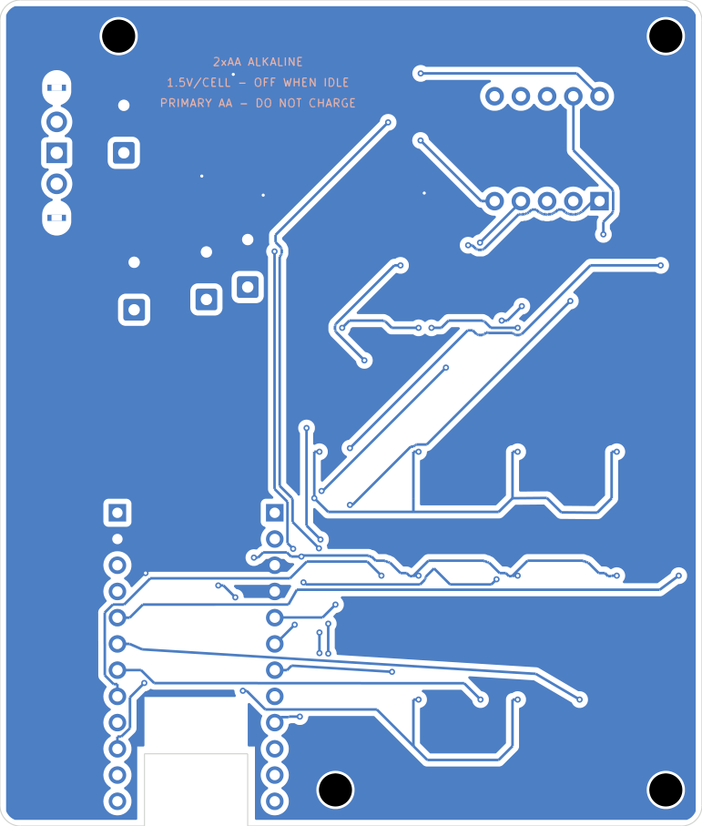

# Remote PCB — KiCad Rev J

This directory contains the **actual editable design files** from `ARS_clicker_nRF_RevJ.zip`, not reconstructions from report screenshots.

**Open in KiCad:** `kicad/ARS_clicker_RevJ/ARS_clicker_nRF.kicad_pro`. The corresponding schematic and PCB are `ARS_clicker_nRF.kicad_sch` and `ARS_clicker_nRF.kicad_pcb`. The custom symbol and footprint libraries are distributed with the project.

- `kicad/ARS_clicker_RevJ/gerber_prototype/` — supplied manufacturing files, for prototype review (do not fabricate before confirming DRC and revision)
- `kicad/ARS_clicker_RevJ/BOM_ARS_nRF52840_RevJ.xlsx` — editable original cost and sourcing model
- `kicad/ARS_clicker_RevJ/verification/` — supplied ERC/DRC/other audit summaries (not rerun here)
- `kicad/ARS_clicker_RevJ/previews/` — exported front/back PCB and schematic previews

The design uses a SuperMini nRF52840, 14-button matrix and two-digit LED. An external AA/USB boost module feeds 5 V to the SuperMini USB input; do not connect this to a 3.3 V GPIO or rail. Validate antenna keepout, battery-voltage range and PCB assembly with hardware before production.

